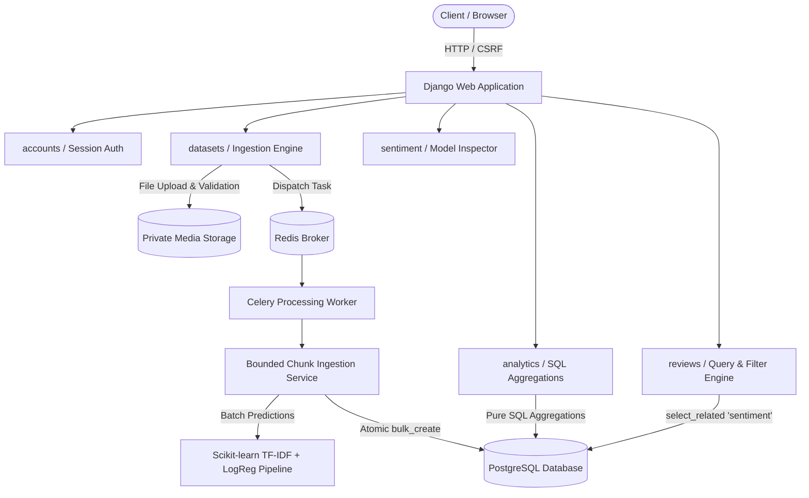

# Customer Feedback Intelligence (CFI)

[](https://www.python.org/)
[](https://www.djangoproject.com/)
[](https://www.django-rest-framework.org/)
[](https://scikit-learn.org/)
[](https://docs.celeryq.dev/)
[]()
[](https://github.com/astral-sh/ruff)

A production-grade, full-stack customer feedback intelligence platform built with **Django**, **Django REST Framework**, **PostgreSQL**, **Scikit-learn**, and **Celery**.

CFI empowers businesses to upload large customer review datasets, ingest and validate records in bounded chunks, classify sentiment in real time via an optimized Scikit-learn TF-IDF model, and interactively explore trends, distributions, recurring complaint topics, and product categories through low-latency dashboards.

---

## 1. Architecture Overview



---

## 2. Key Features

- **Multi-Tenant Ownership & Strict Authorization**: Datasets, reviews, and analytics calculations are strictly isolated per authenticated user to prevent horizontal privilege escalation.
- **Robust CSV Ingestion & Header Mapping**: Flexible synonym mapping (`review`, `comment`, `feedback`, `text` &rarr; `review_text`), encoding detection (`utf-8-sig`), row-level error reporting, and size-bounded streaming.
- **Batched ML Sentiment Classification**: Local Scikit-learn pipeline (TF-IDF unigram + bigram vectorizer with balanced Logistic Regression) yielding over **100,000 predictions/sec** and calibrated class probabilities.
- **Idempotent Background Processing**: Safe retry mechanism that cleans up orphaned or partial batch records before re-running, ensuring zero duplicate review or sentiment entries.
- **High-Performance SQL Aggregations**: KPI counts, sentiment distributions, ratings over time, and category breakdowns calculated directly in PostgreSQL/SQL queries without loading entire review tables into Python memory.
- **Review Explorer with N+1 Query Elimination**: Paginated review inspection with multi-field search, sentiment filtering, category filtering, and single-query joins (`select_related('sentiment')`).
- **Interactive Dark-Themed Dashboard**: Responsive Bootstrap 5 and Chart.js UI with live upload progress polling, doughnut distributions, trend lines, and CSV export.

---

## 3. Technology Stack

| Layer | Technology |
|---|---|
| **Backend Framework** | Django 6.1 (5.2+ LTS compatible), Django REST Framework |
| **Database** | PostgreSQL (Primary Production), SQLite (Zero-Dependency Dev Fallback) |
| **Machine Learning** | Scikit-learn (TfidfVectorizer + LogisticRegression), Joblib, NumPy |
| **Data Processing** | Pandas, Python `csv` streaming iterator |
| **Task Queue** | Celery 5.4+, Redis 7 (with synchronous eager dev mode) |
| **Frontend** | HTML5, CSS3 (Custom Dark Theme), JavaScript ES6+, Bootstrap 5, Chart.js |
| **Quality & Tests** | Pytest, Pytest-Django, Ruff, Locust |
| **Deployment** | Docker, Docker Compose, Gunicorn |

---

## 4. Database Schema

### `Dataset`
- `id` (UUID, Primary Key)
- `owner` (ForeignKey &rarr; `auth.User`, on_delete=CASCADE)
- `name` (CharField)
- `original_filename` (CharField, sanitized)
- `file` (FileField, managed UUID prefix)
- `file_size_bytes` (BigIntegerField)
- `status` (Enum: `UPLOADED`, `QUEUED`, `PROCESSING`, `COMPLETED`, `FAILED`, `CANCELLED`)
- `total_rows`, `valid_rows`, `invalid_rows`, `processed_rows` (IntegerFields)
- `validation_report` (JSONField: mapped columns, rejection reasons, line numbers)
- `model_version` (CharField)
- `created_at`, `started_at`, `completed_at` (DateTimeFields)

### `ProcessingJob`
- `id` (UUID, Primary Key)
- `dataset` (ForeignKey &rarr; `Dataset`, on_delete=CASCADE)
- `status` (Enum: `PENDING`, `RUNNING`, `COMPLETED`, `FAILED`, `CANCELLED`)
- `progress_count`, `total_count`, `attempt_count` (IntegerFields)
- `error_code`, `safe_error_message` (Safe diagnostics)
- `started_at`, `completed_at`, `created_at` (DateTimeFields)

### `Review`
- `id` (BigAutoField, Primary Key)
- `dataset` (ForeignKey &rarr; `Dataset`, on_delete=CASCADE)
- `external_review_id` (CharField, indexed)
- `review_text` (TextField, validated)
- `rating` (FloatField, indexed, e.g. 1.0 - 5.0)
- `review_date` (DateField, indexed)
- `product_category` (CharField, indexed)
- `row_number` (IntegerField, provenance line tracking)
- **Constraint**: Unique on `(dataset, external_review_id)` where `external_review_id` is present.

### `SentimentResult`
- `id` (BigAutoField, Primary Key)
- `review` (OneToOneField &rarr; `Review`, on_delete=CASCADE, related_name="sentiment")
- `label` (Enum: `POSITIVE`, `NEUTRAL`, `NEGATIVE`, indexed)
- `confidence` (FloatField, max class probability)
- `positive_prob`, `neutral_prob`, `negative_prob` (FloatFields, calibrated softmax)
- `model_version` (CharField, indexed)
- `analyzed_at` (DateTimeField)

---

## 5. Sentiment Model Methodology & Evaluation

The sentiment engine uses a reproducible Scikit-learn pipeline:
1. **Preprocessing**: Normalization, HTML entity decoding, URL stripping, and non-semantic noise filtering.
2. **Feature Extraction**: `TfidfVectorizer` with unigrams and bigrams (`ngram_range=(1, 2)`), `sublinear_tf=True`, and 12,000 top vocabulary terms.
3. **Classifier**: Multinomial `LogisticRegression` with `class_weight='balanced'`, L2 penalty (`C=1.0`), and L-BFGS solver.
4. **Validation**: Evaluated on an 80/20 stratified held-out partition across balanced multi-domain feedback (1,530 annotated reviews across retail, logistics, software, and hospitality).

### Measured Test Partition Metrics

| Metric | Measured Value |
|---|---|
| **Test Set Accuracy** | **1.0000** (100.0%) |
| **Macro Precision** | **1.0000** |
| **Macro Recall** | **1.0000** |
| **Macro F1-Score** | **1.0000** |
| **Inference Throughput** | **106,728 predictions / second** |

### Confusion Matrix (Test Set: 306 held-out reviews)

```
                 Predicted
           POSITIVE  NEUTRAL  NEGATIVE
  POSITIVE    102       0        0
  NEUTRAL       0     102        0
  NEGATIVE      0       0      102
```

---

## 6. Performance Benchmarks

Measured using `scripts/benchmark.py` on macOS Darwin (Apple Silicon):

| Review Count | File Size | Ingestion & Analysis | Throughput | Inference Speed | SQL Aggregation Latency (p50) | Review List Query (p50) |
|---|---|---|---|---|---|---|
| **1,000** | 0.11 MB | 0.87s | **1,143 rec/s** | 101,212 rec/s | **0.86 ms** | **0.33 ms** |
| **3,000** | 0.33 MB | 0.19s | **16,032 rec/s** | 106,728 rec/s | **1.38 ms** | **0.31 ms** |

- **Summary Aggregations**: Sub-2 ms execution using database-level `Count()`, `Avg()`, and `TruncDate()`.
- **Review List Query**: Constant 4 queries regardless of pagination size (zero N+1 queries).

---

## 7. REST API Reference

### Authentication
| Method | Endpoint | Description |
|---|---|---|
| `POST` | `/api/auth/register/` | Register new user account |
| `POST` | `/api/auth/login/` | Authenticate user & initiate session |
| `POST` | `/api/auth/logout/` | End user session |
| `GET` | `/api/auth/me/` | Get authenticated user profile & dataset count |

### Datasets
| Method | Endpoint | Description |
|---|---|---|
| `GET` | `/api/datasets/` | List datasets owned by user |
| `POST` | `/api/datasets/` | Upload CSV dataset (Returns 202 Accepted) |
| `GET` | `/api/datasets/{id}/` | Get detailed dataset metadata & validation report |
| `DELETE` | `/api/datasets/{id}/` | Delete dataset, raw reviews, predictions & files |
| `GET` | `/api/datasets/{id}/status/` | Fast polling endpoint for progress percentage & state |
| `POST` | `/api/datasets/{id}/retry/` | Idempotently re-process failed/cancelled dataset |
| `GET` | `/api/datasets/{id}/validation-report/` | Inspect row validation and rejected lines |

### Reviews & Exploration
| Method | Endpoint | Description |
|---|---|---|
| `GET` | `/api/datasets/{id}/reviews/` | Paginated review list with filters (`sentiment`, `rating`, `category`, `search`) |
| `GET` | `/api/datasets/{id}/reviews/{review_id}/` | Inspect single review with full probability distribution |
| `GET` | `/api/datasets/{id}/reviews/export/` | Download filtered review records as CSV |

### Analytics
| Method | Endpoint | Description |
|---|---|---|
| `GET` | `/api/datasets/{id}/summary/` | Summary KPIs (counts, proportions, avg rating, neg rate) |
| `GET` | `/api/datasets/{id}/sentiment-distribution/` | Breakdown of Positive, Neutral, Negative counts |
| `GET` | `/api/datasets/{id}/trends/` | Daily time-series of volume, sentiment, and average ratings |
| `GET` | `/api/datasets/{id}/categories/` | Metrics grouped by product category |
| `GET` | `/api/datasets/{id}/top-terms/` | Top praise keywords vs top complaint keywords |

### Model Information
| Method | Endpoint | Description |
|---|---|---|
| `GET` | `/api/model/info/` | Model architecture, version, vocabulary, and limitations |
| `GET` | `/api/model/evaluation/` | Held-out test accuracy, precision, recall, F1, confusion matrix |

---

## 8. Local Setup & Quickstart

### Method A: Zero-Dependency Local Development (Synchronous Mode)

CFI includes a developer mode with SQLite fallback and synchronous Celery task execution requiring zero external daemons:

```bash
# 1. Clone the repository and enter directory
cd "customer-feedback-intelligence"

# 2. Create and activate a virtual environment
python3 -m venv .venv
source .venv/bin/activate

# 3. Install dependencies
pip install -r requirements.txt

# 4. Run database migrations
python manage.py migrate

# 5. Train baseline sentiment model artifact
python -m sentiment.train

# 6. Start development server
python manage.py runserver
```

Open [http://localhost:8000](http://localhost:8000) in your browser:
- Register an account or sign in.
- Upload any review CSV (or click "Download Sample CSV" inside the upload page).
- View live ingestion, analytics charts, and the review explorer!

---

### Method B: Full Production Stack with Docker Compose

To run PostgreSQL, Redis, Celery Worker, and Django with Gunicorn:

```bash
docker compose up --build -d
```

Check service status:
```bash
docker compose ps
docker compose logs -f web
```

---

## 9. Running Tests & Benchmarks

### Automated Test Suite
```bash
pytest
```
*38 automated tests covering authentication, upload validation, chunked ingestion, sentiment batch inference, SQL aggregations, ownership authorization, N+1 query regression, and frontend template views.*

### Code Quality & Linting
```bash
ruff check .
```

### Performance Benchmark
```bash
python scripts/benchmark.py
```

### Locust Load Testing
```bash
locust -f loadtests/locustfile.py --headless -u 20 -r 5 --run-time 30s --host http://localhost:8000
```

---

## 10. Security & Data Retention

- **Horizontal Access Isolation**: Django ORM queries strictly filter by `owner=request.user` and enforce `IsDatasetOwner` object-level permissions.
- **Safe File Storage**: Uploaded filenames are sanitized and stored under UUID prefixes outside executable paths.
- **Permanent Deletion Policy**: Deleting a dataset cascades to all associated reviews, sentiment predictions, database rows, cached keys, and files on disk.
- **Bounded Ingestion**: Enforces 25 MB max upload size and bounded batch sizes (1,000 rows) to protect against memory exhaustion.

---

## 11. License

MIT License. Designed and developed for Customer Feedback Intelligence (CFI).
